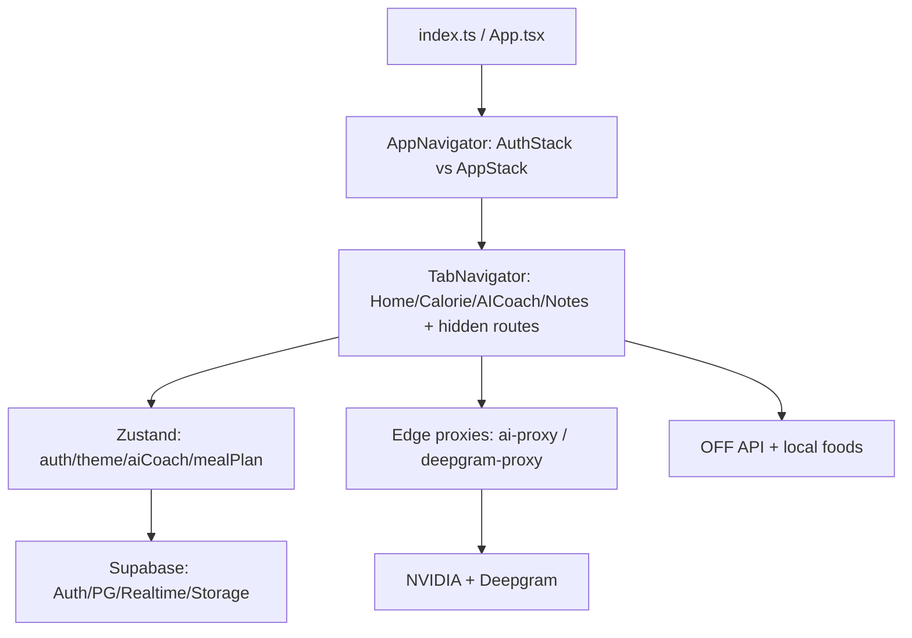

# CalFit — Architecture

- Navigation: Stack + Tabs, custom bar + RadialMenu; gate `!user||isOnboarding`.
- Data flow: screens → services → Supabase; steps/AI via hooks/services; exports via Share/Print.
- Errors: per-screen try/catch + notifications; no global boundary (recommended).
